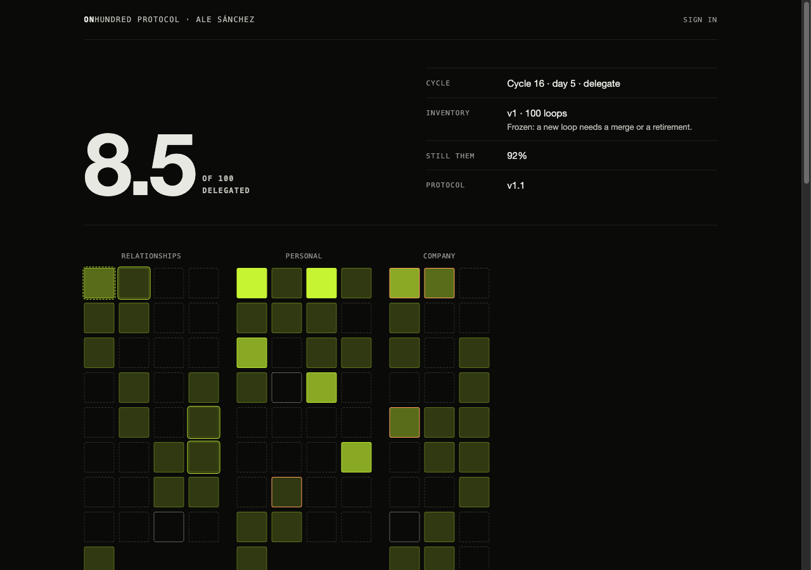
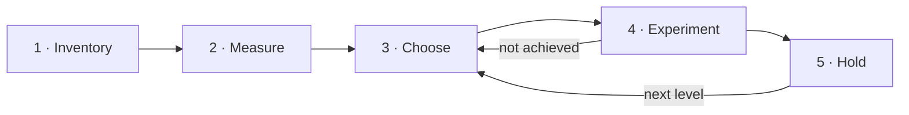
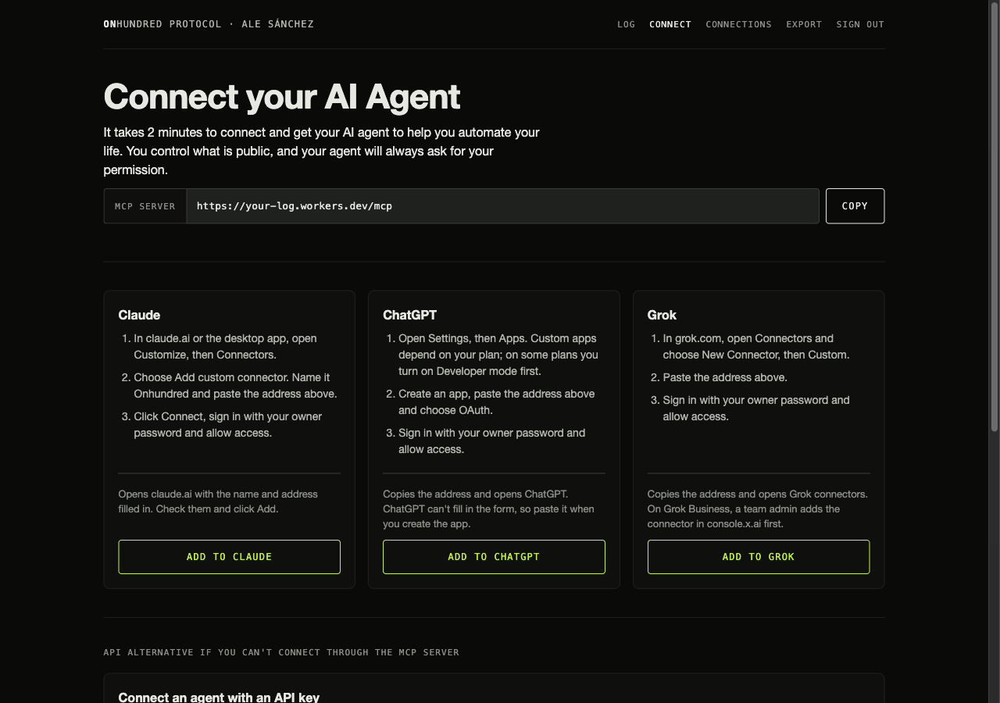
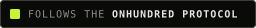

<p align="center">
  <a href="https://onhundred.com"></a>
</p>

<h3 align="center">Hand your 100 recurring responsibilities to AI agents.<br>One experiment at a time.</h3>

<p align="center">
  Your own log and MCP server for the <a href="./docs/protocol.md">Onhundred Protocol</a>.<br>
  It runs on your Cloudflare account, and your data never leaves it.
</p>

<p align="center">
  <a href="https://github.com/onhundred/protocol-log/actions/workflows/test.yml"></a>
  <a href="https://github.com/onhundred/protocol-log/releases"></a>
  <a href="./docs/protocol.md"></a>
  <a href="#what-your-agent-can-do"></a>
  <a href="https://workers.cloudflare.com"></a>
  <a href="./LICENSE"></a>
</p>

<p align="center">
  <a href="#quick-start"><b>Quick start</b></a> ·
  <a href="#how-it-works"><b>How it works</b></a> ·
  <a href="#connect-your-ai"><b>Connect your AI</b></a> ·
  <a href="#what-your-agent-can-do"><b>Tools</b></a> ·
  <a href="./docs/protocol.md"><b>Read the protocol</b></a> ·
  <a href="https://onhundred.com"><b>See it live</b></a>
</p>

<p align="center">
  <a href="https://deploy.workers.cloudflare.com/?url=https://github.com/onhundred/protocol-log"></a>
</p>

<p align="center">
  
</p>

<div align="center">

| **100** | **3** | **2 weeks** | **38** | **2 minutes** |
| :---: | :---: | :---: | :---: | :---: |
| loops in your life | loops at a time | per cycle | MCP tools | to deploy |

</div>

It's easy to say AI will change your work. It's harder to say which loops, by how much and at what cost. This protocol answers that one loop at a time, and keeps the receipts.

Ale Sánchez runs it on his own life and publishes every result at [onhundred.com](https://onhundred.com). This repository is the log behind it. Deploy your own and run it on yours.

> [!WARNING]
> This protocol hands parts of your life and your work to AI agents. It can strain your relationships, disrupt your company and expose your data. Nobody knows how it ends, because nobody has finished it yet.
>
> **Don't start if you can't stop the moment someone you love asks you to.**
>
> If it works, you get back the hours, the money and the attention you spend on everything a machine can do for you.
>
> **Delegate agency.**

## How it works

You split your life (or your job) into exactly 100 recurring responsibilities, called **loops**. Then, a few at a time, you hand each one to an AI agent. It stays there only if the evidence shows it works.



1. **Inventory.** Your agent proposes your 100 loops. You approve the list.
2. **Measure.** You watch each loop happen 3 times to record what it really costs.
3. **Choose.** You work on 3 loops at a time: one easy, one hard and one fun.
4. **Experiment.** You write a question, a bet and how you'll know it worked. Then you try.
5. **Hold.** It has to keep working for 3 more weeks before the loop moves up a level.

Each loop climbs 3 levels: **Help me**, **Do it, I approve** and **Do it alone**.

**3 rules that never bend:** success is defined before a stage starts and never changed afterward. Failures are recorded with the same weight as successes. Nobody else is affected by a delegation without knowing and agreeing to it.

## What you get

<table>
  <tr>
    <td width="33%" valign="top">
      <h4>An agent that does the work</h4>
      38 MCP tools, 4 documents and 3 starter prompts. Claude, ChatGPT, Grok, Cursor and Claude Code build your loops and run your experiments.
    </td>
    <td width="33%" valign="top">
      <h4>Rules agents can't break</h4>
      Every change is checked against the protocol. A change that breaks a rule is rejected, with the rule it broke.
    </td>
    <td width="33%" valign="top">
      <h4>You approve what goes public</h4>
      Names, done-when, scope, questions, bets and lessons an agent writes wait for you, in your AI app or on your log page.
    </td>
  </tr>
  <tr>
    <td width="33%" valign="top">
      <h4>Nothing is erased</h4>
      The history is append-only. Every change carries the name of the agent that made it. An undo is a new event.
    </td>
    <td width="33%" valign="top">
      <h4>Private by default</h4>
      Your log stays private until you publish it. Even then, evidence, consent, notes and partner loops stay out.
    </td>
    <td width="33%" valign="top">
      <h4>Yours, on your account</h4>
      A Worker, a database and nightly backups on your Cloudflare account. The free plan is enough. Export it all as JSON.
    </td>
  </tr>
</table>

## Quick start

You need:

- A Cloudflare account. The free plan is enough.
- A GitHub account. The button creates your own copy of this repository there.
- An AI app that connects to custom MCP servers: Claude, ChatGPT, Grok, Cursor or Claude Code.

Then:

1. Click **Deploy to Cloudflare**.
2. On the setup page, set `OWNER_PASSWORD` and `COOKIE_ENCRYPTION_KEY`.
3. Open your Worker's address and sign in with your owner password.
4. Go to **Connect** and add your log to your AI app.
5. Ask it: "Help me build my 100 loops."

It takes about 2 minutes. Writing your 100 loops takes longer.

<p>
  <a href="https://deploy.workers.cloudflare.com/?url=https://github.com/onhundred/protocol-log"></a>
</p>

<details>
<summary><b>What the button creates</b></summary>

- **A Worker** with your log page and an MCP server at `/mcp`.
- **A D1 database** with your loops, experiments, connections and the full history of changes. The tables are created on first use.
- **A Durable Object** that applies changes one at a time, so two agents can never break a rule together.
- **An R2 bucket** with a JSON snapshot every night.
- **A KV namespace** for the sign-ins of the AI apps you connect.

The setup page asks for 2 secrets:

- `OWNER_PASSWORD`: the password you type to sign in and to allow AI apps to connect.
- `COOKIE_ENCRYPTION_KEY`: 32 characters or more. Generate one with `openssl rand -hex 32`.

At this size, usage stays within Cloudflare's free allowances. If R2 isn't on in your account yet, the dashboard asks you to turn it on first.

</details>

## Connect your AI

Open your Worker's address, sign in, and go to **Connect**. Every app uses the same address: `https://<your-worker>/mcp`.



| App | How to connect |
| --- | --- |
| **Claude** | Customize, Connectors, Add custom connector. Paste the address, click Connect and sign in. |
| **ChatGPT** | Settings, Apps. Create an app with the address and OAuth, then sign in. Custom apps depend on your plan. |
| **Grok** | Connectors, New Connector, Custom. Paste the address and sign in. |
| **Cursor** | Add the snippet below to `~/.cursor/mcp.json`, then click Connect. |
| **Claude Code** | Run the command below, then `/mcp` to sign in. |
| **API agents** | Create an API key under **Connections** and send it as the bearer token. The Connect page has the examples. |

```json
{ "mcpServers": { "onhundred": { "url": "https://<your-worker>/mcp" } } }
```

```bash
claude mcp add --transport http onhundred https://<your-worker>/mcp
```

API agents include the xAI Grok API, the OpenAI Responses API, the Anthropic MCP connector and your own bots.

Then ask: "Help me build my 100 loops."

Each app and key is a named agent. Its name appears in the history next to every change it makes. Revoke any of them under **Connections**, and it stops at once.

## What your agent can do

Your log is an [MCP](https://modelcontextprotocol.io) server. MCP is the standard way AI apps read from and write to other systems. Your log gives your agent 38 tools, 4 documents and 3 starter prompts.

Apps you sign in to get **owner** access. API keys get **agent** or **owner** access, chosen when you create them. Agent access reads and proposes. Only owner access approves, publishes and changes settings.

<details>
<summary><b>Read</b>: 10 tools, any connection</summary>

| Tool | What it does |
| --- | --- |
| `get_state` | Start here: settings, cycle, both metrics, what waits for approval and any rule the log breaks. |
| `list_loops` | Loops with level, flag, last outcome and triage group. |
| `get_loop` | Every field of 1 loop, including private ones. |
| `list_experiments` | Experiments with slot, question, status and stage. |
| `get_experiment` | The full card of 1 experiment, with every stage, hold and conclusion. |
| `get_triage` | Loops grouped into Automate now, Later and Not yet. |
| `suggest_slots` | The loops the protocol puts in each empty slot. |
| `list_pending` | Everything waiting for the owner, next to the live version. |
| `check_rules` | Every protocol check on the current log. |
| `get_events` | The append-only history of every change. |

</details>

<details>
<summary><b>Propose and record</b>: 13 tools, any connection, every change checked against the rules</summary>

| Tool | What it does |
| --- | --- |
| `propose_loops` | Proposes new loops. They stay hidden until the owner approves them. |
| `rename_loop` | Changes a name, "done when" or scope. On an approved loop it waits for approval. |
| `update_loop` | Updates the estimate, triage scores, evidence or grid order. |
| `split_loop` | Proposes 2 or more loops to replace 1. |
| `merge_loops` | Proposes 1 loop to replace 2 or more. |
| `retire_loop` | Proposes retiring a loop, with the reason. |
| `set_measuring` | Starts or stops measuring an unmapped loop. |
| `record_baseline` | Records what a loop costs today. |
| `register_stage_try` | Registers the next stage of an experiment before it starts. |
| `close_stage_try` | Closes a stage as achieved, not achieved or terminated. |
| `record_hold` | Records whether an achieved stage kept passing for 3 weeks. |
| `record_drop` | Moves a loop down after failing days, harm or lost consent. |
| `add_learned` | Adds the public lesson of a closed stage. It waits for approval. |

</details>

<details>
<summary><b>Owner</b>: 15 tools, owner access only. Your agent confirms with you before the ones that publish or approve.</summary>

| Tool | What it does |
| --- | --- |
| `approve_loops` | Approves proposed loops and applies retirements. |
| `approve_text` | Publishes text agents wrote. |
| `reject_text` | Discards pending text. The live version stays. |
| `approve_baseline` | Approves a baseline. The loop moves to mapped. |
| `set_published` | Publishes a partner loop once your partner agrees. |
| `freeze_inventory` | Freezes the inventory at exactly 100 loops. |
| `register_experiment` | Registers an experiment: slot, question, bet, loops and goal. |
| `conclude_experiment` | Records the bet as confirmed, refuted or unclear. |
| `set_meta` | Changes settings: your name, languages, publishing, the cycle and the grid. |
| `adopt_protocol` | Moves your log to the protocol version in this code. |
| `undo_event` | Restores the values from before an event, as a new event. |
| `override` | Runs 1 change past the checks, for emergencies, and records it. |
| `list_connections` | Lists API keys and signed-in apps. |
| `create_api_key` | Creates an API key. It is shown once. |
| `revoke_api_key` | Revokes an API key at once. |

</details>

**Documents** your agent reads: the protocol, `LOOPS.md` (how to write a loop), `VOICE.md` (how to write public text) and `protocol.json` (the numbers the rules use).

**Starter prompts:** "Help me build my 100 loops", "Which loops should fill my 3 slots?" and "Run my cycle review". Apps that support MCP prompts show them as shortcuts.

**A link after every change.** Each write returns where the grid stands, what moved and a link. Your agent ends its reply with that link, so you watch your grid change as you go. The squares that moved light up. For connections with owner access, the link opens your log without a sign-in for 24 hours. That view can't change anything, and it stops working when you revoke the connection. Approving still needs your sign-in.

## How changes work

- **Every change is checked.** A change that would break a protocol rule is rejected with the rule it broke. A log that's already broken can be repaired 1 step at a time.
- **Public text waits for you.** Names, done-when, scope, questions, bets and lessons an agent writes stay pending until you approve them, in your AI app or on your log page.
- **Levels never change by hand.** Only held stages raise them and drops lower them.
- **Nothing is erased.** The history is append-only. An undo is a new event that restores the old value.

## What stays private

Your log is private unless you set `PUBLISH` to `"true"`. Even then, these are never published:

- where each loop came from (`evidence`)
- the people involved in an experiment and their consent
- raw stage notes
- company money and time figures, unless you turn on `companyFigures`
- partner loops (R-PAR) and their experiments, until your partner agrees to publish them
- text that's still waiting for your approval

The public page and `/public.json` render from an allowlist, so any new field stays private by default.

## Your data

- **Export:** sign in and click **Export** for the whole log as JSON. It includes private fields, and leaves out your password, API keys and connections.
- **Backups:** a snapshot lands in your R2 bucket every night at `snapshots/YYYY-MM-DD.json`.

## Security

- **Your sign-in** is the owner password, checked in constant time. The session cookie is signed with `COOKIE_ENCRYPTION_KEY`, lasts 30 days and is `HttpOnly`, `Secure` and `SameSite=Lax`.
- **Failed sign-ins:** 10 failures from 1 address lock sign-in from there for 15 minutes.
- **AI apps** sign in through OAuth with your owner password. Each one gets a grant you can revoke under **Connections**.
- **API keys** start with `ohk_`, are shown once and are stored only as a SHA-256 hash.
- **View links** from your agent are signed with `COOKIE_ENCRYPTION_KEY`, last 24 hours and die when you revoke the connection. On arrival the pass becomes an `HttpOnly` cookie, leaves the address bar and is never sent as a referrer.
- **Owner forms** only accept requests from your log's own address.

Found a vulnerability? Report it privately, as [SECURITY.md](./SECURITY.md) explains. Please don't open a public issue.

## Reference

<details>
<summary><b>Settings</b>: the variables you can change after setup</summary>

The setup page asks only for `PUBLISH` and `LANGUAGES`. Add the others later under your Worker's Settings, Variables and Secrets:

| Variable | What it does |
| --- | --- |
| `PUBLISH` | `"true"` shows your grid and `/public.json` to everyone |
| `LANGUAGES` | Languages of your names and questions, like `en` or `en,es` |
| `OWNER_NAME` | The name at the top of your log |
| `PUBLIC_URL` | Your custom domain, if you add one |

`PUBLISH_HOOK_URL` is an optional secret: a deploy hook called 1 minute after the public view changes, to rebuild a site that shows it. Set it with `npx wrangler secret put PUBLISH_HOOK_URL`, or as a Secret in the dashboard, so it survives redeploys and stays out of your repo.

Your agents can change the rest with `set_meta`: the cycle start date, the "still you" figure, the grid layout.

</details>

<details>
<summary><b>Updates</b>: how new versions reach your log, and how to roll back</summary>

New versions of this template are published as releases named `vX.Y.Z`. Once a week, the **Update from template** workflow in your repository checks for a newer one. You can also run it from the Actions tab.

1. **A pull request arrives** with the release notes, the protocol version change, and the files you edited since the last update. Template files overwrite your copies; `wrangler.jsonc` keeps your name, vars, routes, account id and resource ids.
2. **Merge it to deploy.** Cloudflare rebuilds your Worker from the merged code.
3. **Adopt the new protocol version** from the notice on your log page, or ask your AI app to call `adopt_protocol`. Your log keeps the old rules until you do. With no cycle running, the new rules apply at once; otherwise at the start of the next cycle. Anything that breaks the new rules shows under "Waiting for you": rename it through your AI app.
4. **Reconnect your AI app** so it loads the new tools and descriptions.

If the workflow isn't allowed to open pull requests, it pushes the branch and opens an issue with the link and the setting to change (Settings, Actions, General, "Allow GitHub Actions to create and approve pull requests").

Changes to the workflow file itself can't be applied by the workflow. When one ships, the pull request says so, with the file to copy by hand.

**If an update breaks something:**

1. In the Cloudflare dashboard, open your Worker, then Deployments, and roll back to the previous version. Your log is back at once.
2. In GitHub, revert the update's pull request, so the next deploy doesn't bring it back.

Rolling back is always safe for your data: database changes only ever add tables and columns, never drop or rename them.

</details>

<details>
<summary><b>Troubleshooting</b>: forgotten password, locked sign-in, missing tools</summary>

- **I forgot my owner password.** In the Cloudflare dashboard, open your Worker, then Settings, Variables and Secrets, and set a new `OWNER_PASSWORD`. Or run `npx wrangler secret put OWNER_PASSWORD`. Changing `COOKIE_ENCRYPTION_KEY` too signs out every browser.
- **Sign-in says it's locked.** Too many wrong passwords from your address. Wait 15 minutes.
- **The deploy stops at R2.** Turn on R2 in your Cloudflare account, then deploy again.
- **ChatGPT won't let me add the app.** Custom apps depend on your plan. On some plans you turn on Developer mode first.
- **My agent doesn't see a new tool after an update.** Disconnect and reconnect your AI app.
- **The update workflow opened an issue instead of a pull request.** Follow the link in the issue, then allow GitHub Actions to create pull requests in Settings, Actions, General.
- **My install never gets updates.** If you deployed it before October 2026, it came from the `app/` folder of `onhundred/web`. Copy `.github/workflows/update-from-template.yml` from this repository into yours, once.

</details>

<details>
<summary><b>Uninstall and delete your data</b></summary>

1. Export your log first if you want to keep a copy.
2. Remove the connector from each AI app.
3. In the Cloudflare dashboard, delete your Worker. Its Durable Object goes with it, and every app and key stops at once.
4. Under Storage and Databases, delete the D1 database (`onhundred-log`), empty and delete the R2 bucket (`onhundred-log-backups`), and delete the KV namespace your Worker used. The names may differ if you changed them at setup.
5. Delete your copy of this repository on GitHub.

</details>

## Status

Early. This is v1 of the template, and the protocol is pending external review. It is part of Social Experiment 001: Ale Sánchez runs the protocol on his own life and publishes the results at [onhundred.com](https://onhundred.com). Rules can change between protocol versions. Your log keeps its version until you adopt a new one.

To hear about new protocol versions, click **Watch**, then **Custom**, then **Releases**.

## Contributing

Bug reports, fixes and translations are welcome. [CONTRIBUTING.md](./CONTRIBUTING.md) covers local development, the checks a change must pass and how releases work. Questions go to [Discussions](https://github.com/onhundred/protocol-log/discussions).

## Credit and license

- **The code** is licensed under [Apache 2.0](./LICENSE). Keep the [NOTICE](./NOTICE) file in copies.
- **The protocol text** in `docs/` is licensed under [CC BY 4.0](./docs/LICENSE.md). Share and adapt it, with credit.
- **The Onhundred name and logo** follow [TRADEMARKS.md](./TRADEMARKS.md).

When you publish your log, share the protocol or say you follow it, credit it like this:

> Based on the Onhundred Protocol by Ale Sánchez, [onhundred.com](https://onhundred.com)

Your log page and `/public.json` already include this credit. To show it on your own site, add the badge:

[](https://onhundred.com)

```html
<a href="https://onhundred.com"></a>
```

---

<p align="center">
  <a href="https://onhundred.com"></a>
  <br>
  <sub>Built by <a href="https://onhundred.com">Ale Sánchez</a> for Social Experiment 001. Delegate agency.</sub>
</p>
